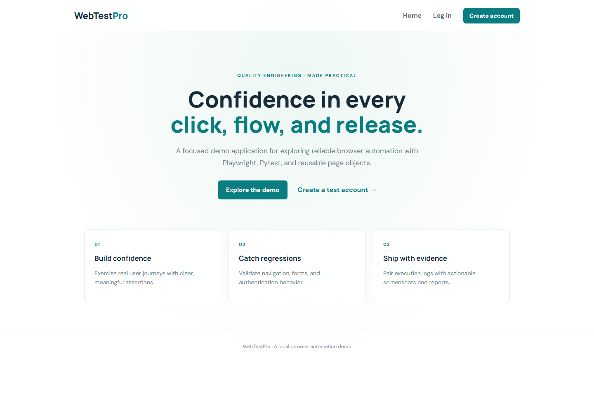
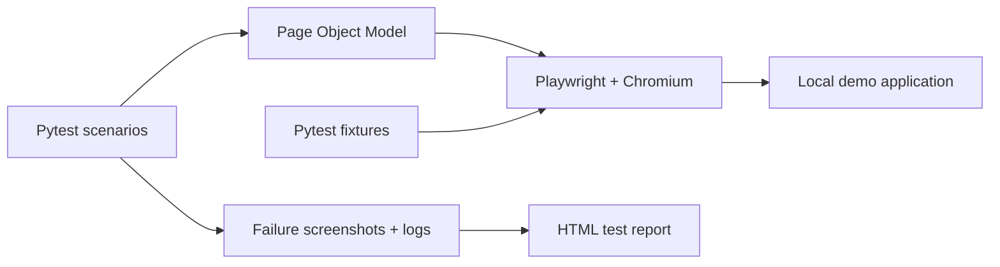

# WebTestPro

**A practical browser automation framework built with Python, Playwright, and Pytest.**

WebTestPro pairs a small local web application with an automated test suite. The app gives the tests real pages and user journeys to exercise, while the framework provides reusable page objects, isolated browser contexts, failure screenshots, logs, and an HTML report.

> This is a learning and portfolio project. Authentication is simulated in the browser with local storage. The demo is not intended for real accounts or production use.

## What it covers

- Login success, invalid credentials, malformed email, and required fields
- Registration success, required fields, invalid email, weak password, mismatch, and duplicate email
- Home page navigation, dashboard profile details, logout, and access denial after logout
- Chromium runs in headless or headed mode
- Failure screenshots, execution logs, and a self-contained HTML report

## Sample application

The application is served locally by the test runner. It uses synthetic data and does not contact an authentication service.



Demo login: `alex@example.com` / `DemoPass123`

## How it fits together



## Project layout

```text
app/                 Static demo application (HTML, CSS, JavaScript)
pages/               Shared and page-specific browser actions
tests/               Login, registration, forms, navigation, dashboard tests
utils/               Configuration, synthetic test data, helpers
reports/             Generated HTML report and execution log (ignored by Git)
screenshots/         Failure screenshots (ignored by Git)
docs/images/         Documentation screenshots
conftest.py          Browser, context, page, and failure-capture fixtures
pytest.ini           Pytest discovery and markers
run_tests.py         Starts the app and runs Pytest
requirements.txt     Pinned Python dependencies
```

## Requirements

- Python 3.11 or newer
- Windows, macOS, or Linux

## Install

From the project directory:

```powershell
python -m venv .venv
.\.venv\Scripts\Activate.ps1
python -m pip install -r requirements.txt
playwright install chromium
```

On macOS or Linux, activate the environment with `source .venv/bin/activate`.

## Run the suite

The runner starts a local HTTP server for the sample app, creates the output folders, runs the tests, writes the report, and returns a failing exit code if the suite fails:

```powershell
python run_tests.py
```

Run a single file or test by passing normal Pytest arguments:

```powershell
python run_tests.py tests/test_login.py
python run_tests.py tests/test_registration.py -k duplicate
```

Run with a visible browser:

```powershell
$env:WEBTESTPRO_HEADED = "1"
python run_tests.py
```

Set `WEBTESTPRO_TIMEOUT_MS` to change the default browser action timeout, or `WEBTESTPRO_BASE_URL` to point tests at another running instance of the app. To use Pytest directly, first serve the `app/` directory at the configured base URL, then run `pytest`.

## Reports and screenshots

After a run, open `reports/report.html` for test names, outcomes, durations, and failure details. The framework writes execution logs to `reports/test_execution.log` and captures a uniquely named full-page image under `screenshots/` when a test fails. Generated reports, logs, and failure captures are excluded from Git to keep commits small and avoid publishing local run data.

## Framework notes

- Page classes in `pages/` keep selectors and browser actions out of test logic.
- `conftest.py` creates a fresh browser context for each test, so local storage and sessions do not leak between cases.
- Synthetic account data lives in `utils/test_data.py` and can be changed for local experiments.
- Pytest markers are declared in `pytest.ini`; use `@pytest.mark.smoke` or `@pytest.mark.regression` as the suite grows.

## Ideas for extending it

- Add Firefox and WebKit browser projects
- Add CI execution and stored report artifacts
- Add accessibility checks and mobile viewport coverage
- Add API fixtures for larger test environments

## License

No license has been selected yet. Add one before redistributing or reusing the project outside your own portfolio.
